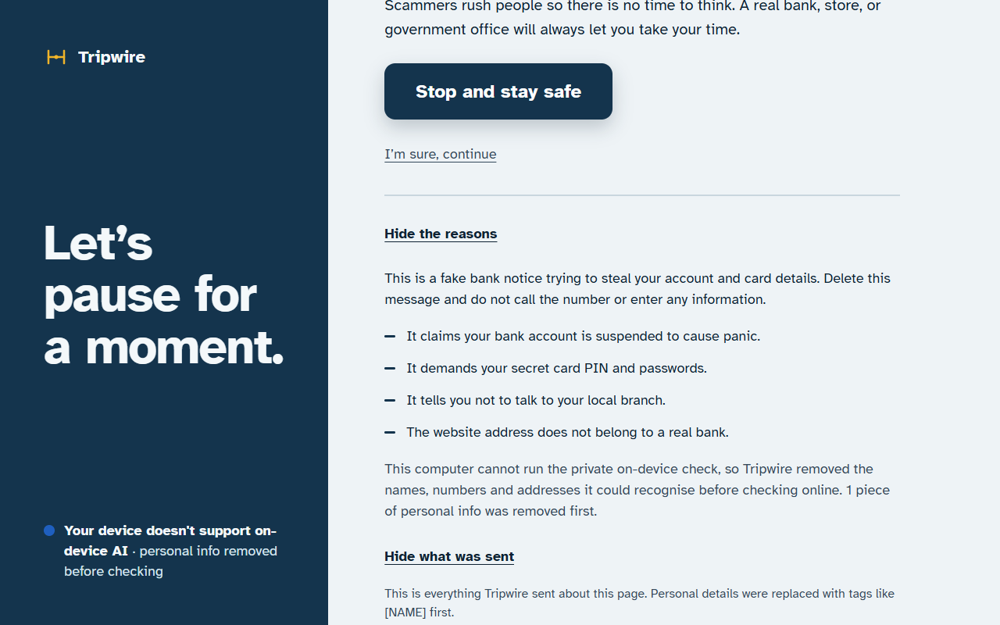
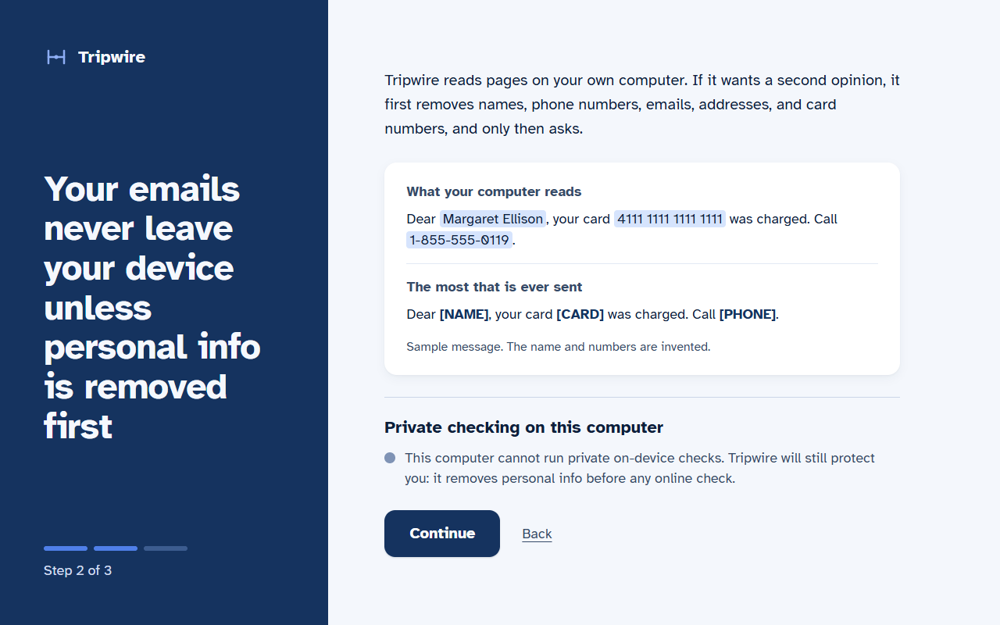
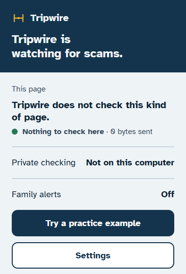

# Tripwire

**Tripwire steps in at the exact moment you're about to fall for a scam (on a page, in an email, or on the phone) and protects your privacy while doing it.**

A Chrome extension for older adults and the family who look out for them. Built for the Firebase #BuildHybridAI 2026 hackathon (Web / Chrome track). Licensed under Apache-2.0.

Scams do not take your money when you read them. They take it when you act: when you type a card number, buy gift cards, install a "support" program, or call the number on the screen. Tripwire stays invisible until that moment, then pauses you with one calm question: *did someone call, text, or email you and ask you to do this?*

**Try it now, with nothing to install:** https://tripwire-buildhybridai.web.app/demo/ runs Tripwire's real checks and screens in your browser, through Firebase AI Logic. If your Chrome has its on-device model the check runs on your device; otherwise personal details are removed first and the cloud model is asked.

## At a glance

```
page, email or phone call
  │
  ├─ built-in warning signs (no AI) ── nothing suspicious ──► silent, nothing sent
  │
  └─ Gemini Nano on the device (Firebase AI Logic, ONLY_ON_DEVICE)
        ├─ clearly safe or clearly a scam ────────────────────► decided here, nothing sent
        └─ unsure ── names, numbers, addresses removed on the device ──► cloud model (ONLY_IN_CLOUD)
                     (leak check fails → nothing is sent, the device decides)
```

| Result (26 Nov) | Scams caught | False alarms | Sent to the cloud |
| --- | --- | --- | --- |
| Gemini Nano in the built extension, 50 messages | 25 / 25 | 0 / 25 | 4,207 bytes, all redacted first |
| Cloud only (no on-device model) | 25 / 25 | 0 / 25 | 22,018 bytes, all redacted first |
| Phone-call check, Gemini Nano, 20 calls | 12 / 12 | 0 / 8 | |

191 unit tests, 29 security-rules tests, a 14-step end-to-end run with 0 accessibility problems, a live run against the real Firebase project. Details are in [Test results](#test-results).

## Why this matters

Figures from the US Federal Trade Commission, read in November 2026:

- Fraud losses reported by older adults rose from about $600 million in 2020 to about $3 billion in 2025 ([FTC consumer alert, 4 Nov 2026](https://consumer.ftc.gov/consumer-alerts/2026/11/new-report-ftcs-work-protect-older-adults)).
- Reports from older adults who lost $10,000 or more to business or government imposters rose more than fourfold from 2020 to 2024 (1,790 to 8,269 reports). In 2024 older adults were more than twice as likely as younger adults to report a loss that size ([FTC Data Spotlight, Aug 2025](https://www.ftc.gov/news-events/data-visualizations/data-spotlight/2025/08/false-alarm-real-scam-how-scammers-are-stealing-older-adults-life-savings)).
- The pattern the FTC describes is the one Tripwire is built around: a false alarm ("someone is using your accounts"), then pressure to move money "to protect it". Its advice: "Only scammers will tell you to buy a gift card ... and give them the numbers off the back of the card" ([FTC](https://consumer.ftc.gov/articles/avoiding-and-reporting-gift-card-scams)).

These are published figures, not our own research. Tripwire has not been tested with older users yet; `PRODUCT.md` says so.

## How this differs from the protection already in a browser

Browsers block known bad sites and warn about dangerous pages, and Chrome's Enhanced Protection now also uses Gemini Nano to spot tech-support scam pages. That is a page-level warning for one kind of scam, for people who opted in to sending more browsing data to Google. Tripwire does five different things, for every kind of scam in the corpus (government and bank imposters, gift cards, crypto, family emergencies, refunds, romance), with standard browser settings:

1. **It acts at the moment of action**, not on page load: a card field, a gift-card code box, a wallet address, a phone link, a remote-access download.
2. **It reads the message, not the address.** A brand-new scam email on an ordinary mail site has no bad URL to block.
3. **It shows its work.** Every verdict says what left the computer, and "See exactly what was sent" shows the redacted text itself.
4. **It brings in family** without showing them anything private.
5. **It covers the phone call**, where most of these scams start. No browser can hear a call, so the person taps what the caller wants (no typing) and gets a plain answer while still on the line.

## What it does

| State | What the person sees |
| --- | --- |
| Safe | Nothing at all. No badge, no banner. |
| Caution | A calm amber banner with one plain sentence, a "Why?" button and "Dismiss". |
| Tripped | A full-page pause. "Stop and stay safe" is the big button; "I'm sure, continue" is a quiet link. |

Action tripwires: typing or focusing a card number field (Luhn checked, locally), gift-card code fields, crypto wallet fields, phone links (held until the page has been checked), and downloads of remote-access tools (always asked about once, because the caller often names the site).

**Someone on the phone?** Most scams on older people start with a call, which no browser can see. From the Tripwire menu, "Someone is on the phone with me" opens a page where the person answers three questions by tapping big buttons, with no typing: who the caller says they are, what they want (money, gift cards, crypto, a code from the phone, personal details, access to the computer) and how they are acting (rushing, secrecy, "stay on the line"). Tripwire turns the taps into a plain English description, plus anything the person chooses to type, so the model reads clear English whatever language the screen is in. Gemini Nano checks it on the computer first (a redacted second opinion only if it is unsure), and the answer is plain: "Hang up now.", "Be careful." or "Nothing here sounds like a scam", always with "call back on a number you already know". "I hung up" sends the family alert.

**Family Guardian** (optional): the person shows a six-digit code, a family member types it on the family page, and from then on sees a live feed of *that Tripwire stepped in*: the time, the kind of scam, the action, and whether they stopped. Never the page, the email, or anything typed. There is a web family page and an Android app (see [Android companion](#android-companion)).

**Settings**: a three-step warning level (fewer warnings, standard, more careful) and a list of trusted sites that Tripwire never checks. The trusted-sites screen carries a warning written for the exact way a scammer would try to abuse it.

**Explanations in your language**: when the browser is not set to English, the reasons are written in the browser's language. A verdict that never left the device is translated on the device, so "nothing left your computer" stays true; a verdict that used the cloud is written in that language by the cloud model. Every screen follows the browser language too, in English, Spanish or French: the banner, the pause, the reasons, the "you stopped" page, setup, the menu, settings and the family page. Detection works in Spanish and French too: the request-shape rules that decide whether a page reaches a model know Spanish and French words for payments, pressure, secrecy and credentials ([tests/multilingual.test.ts](tests/multilingual.test.ts)), and the on-device model reads the text as it is. The keyword lists behind the rules-only fallback have Spanish and French phrases too, tested with no model at all. The one sentence stored with a family alert stays English, because the security rules check it word for word; the family page shows it in the reader's language.

## Screenshots

The first picture was captured in desktop Chrome 157 with Gemini Nano answering, on the hosted practice pages (`node scripts/nano-probe.mjs --shots`); the second is the hosted demo in a browser with no on-device model (`npm run hosted`). The rest come from `npm run e2e` in a Chromium that has no on-device model, so their badges show the fallback route.

| On the device, nothing sent | With no on-device model: the route, and the receipt of what was sent |
| --- | --- |
|  |  |

| Caution | Tripped |
| --- | --- |
|  |  |

| After stopping | A paused download |
| --- | --- |
|  |  |

| Setup: the privacy promise | Popup |
| --- | --- |
|  |  |

| Settings | Family page: alerts (sample data) |
| --- | --- |
|  |  |

## How it uses Firebase AI Logic

All AI inference goes through Firebase AI Logic (`firebase/ai`), in one file: [src/inference/firebaseEngine.ts](src/inference/firebaseEngine.ts). There are no other model APIs anywhere in the codebase, and no Gemini API key: the Firebase AI Logic proxy holds it server-side.

The on-device model is used as a **privacy gate in front of the cloud**:

```
page text
   │
   ▼
built-in warning signs (rules, no AI) ── nothing suspicious ──► not checked, nothing sent
   │
   ▼
Gemini Nano on the device (InferenceMode.ONLY_ON_DEVICE)
   │  low risk ────────────────────────────────────────────────► safe, nothing sent
   │  high risk, confident, rules agree ───────────────────────► TRIPPED, nothing sent
   ▼  unsure
regex redaction → on-device model redaction → regex again → leak check (fails closed)
   │
   ▼
Gemini in the cloud (InferenceMode.ONLY_IN_CLOUD), redacted text only
   │
   ▼
merged verdict: safe / caution / tripped
```

Every verdict carries a `route`, shown to the person in plain words:

- **Checked on your device · nothing left your computer**
- **Personal info removed · sent for a deeper check**
- **Your device doesn't support on-device AI · personal info removed before checking**
- **Checked with built-in safety rules · nothing left your computer** (offline, or no model reachable)

What decides each step (all of this was changed after a held-out test, see "Test results"):

- **The gate is the shape of the request, not just keywords.** A page is worth a look when it asks for money or credentials and adds pressure, secrecy or a number to call ([src/inference/shape.ts](src/inference/shape.ts)). The on-device look is generous, because it sends nothing. With no on-device model the bar is higher, because something would leave the device.
- **Models read an excerpt, not the page.** A long page is cut to its opening plus the sentences that carry the ask (at most 1,800 characters). This keeps the on-device model to a few seconds and means less can ever be sent.
- **On-device redaction lists, code replaces.** The on-device model returns the personal details it finds; the replacing is done in code, so nothing can be paraphrased or dropped, and it is several times faster than asking a small model to rewrite the text.
- **A page that is about scams never trips on the small model alone.** Advice pages and encyclopaedia articles contain every scam phrase there is; the cloud model has to agree.

Details worth knowing:

- The router ([src/inference/router.ts](src/inference/router.ts)) pins the inference mode for each call instead of using `PREFER_ON_DEVICE`, and checks `response.inferenceSource`. If a call that must stay on the device was answered by the cloud, it throws a `PrivacyInvariantError` and the result is discarded.
- Model output is structured JSON validated with zod. A bad answer is retried once, then Tripwire fails **safe** (caution), never open.
- Thresholds, prompt version and keyword lists come from **Remote Config** (parameter `tripwire_config`, JSON) with local defaults in [src/config/defaults.ts](src/config/defaults.ts).
- **App Check** is initialised before any AI or Firestore call. reCAPTCHA cannot load on a `chrome-extension://` origin under Manifest V3, so the release build (`npm run zip:store`) uses a `CustomProvider` whose tokens come from Tripwire's own hosted site: the offscreen document keeps a hidden frame open on `/attest.html`, which passes a real reCAPTCHA Enterprise check and hands back an App Check token for the same web app ([src/firebase/attest.ts](src/firebase/attest.ts), [dashboard/src/attest.ts](dashboard/src/attest.ts)). No server and no paid plan, and the release build contains no debug token (the build script checks every file). The extension's ID is fixed by a public key in the manifest ([src/config/extensionKey.json](src/config/extensionKey.json)), so the site lets only that extension frame the page (`frame-ancestors`) and the page answers only that ID. Development and automated test builds use a debug token from `.env` instead, because reCAPTCHA rightly refuses automated browsers. The hosted family page attests with reCAPTCHA Enterprise too, and the Android app uses the debug provider in debug builds and Play Integrity in release builds. **App Check is enforced on both Firebase AI Logic and Firestore.**
- Chrome's Prompt API is not available in service workers, so inference runs in an **offscreen document** ([src/entrypoints/offscreen](src/entrypoints/offscreen/main.ts)).
- Other Firebase products: anonymous **Auth** (the device identity), **Firestore** (pairing codes and alerts), **Hosting** (family page).

## Privacy guarantees, and where they are enforced

| Promise | Enforced by |
| --- | --- |
| Raw page or email text never reaches the cloud model, apart from details the redaction does not recognise (an unusual name in ordinary prose, see "What is not guaranteed") | `redactForCloud` fails closed on every detail it found; router tests assert the cloud prompt contains no raw PII ([tests/router.test.ts](tests/router.test.ts)) |
| Password fields are never read | [src/tripwires/cardField.ts](src/tripwires/cardField.ts); only visible text is scanned |
| A Guardian alert holds five fixed fields and no free text | `buildAlert` takes enums only; [firestore.rules](firestore.rules) require the summary to be the one fixed sentence for that kind of scam and reject anything else ([tests/rules](tests/rules/guardian.rules.test.ts), 19 tests; result file [eval-results/rules-tests.json](eval-results/rules-tests.json)) |
| The person can see what was sent | "See exactly what was sent" in the reasons panel shows the redacted request text ([src/ui/kit.tsx](src/ui/kit.tsx)) |
| A pairing code works once, for five minutes | The security rules let exactly one person claim a code, in the same write that creates the link ([firestore.rules](firestore.rules)); the extension also deletes it and says who connected; settings can disconnect everyone |
| A guardian sees nothing until the person allows them | A live code creates a link, but the rules let a guardian read alerts only after the person taps "Yes, allow" on their own computer, and only the device can approve. The prompt shows the first name the family member typed ("Sam just typed your code."), and approving covers only the link made with the code on screen. A guessed code achieves nothing. Codes cannot be listed ([tests/rules](tests/rules), 24 tests) |
| Nothing is stored about pages | Verdicts live in `chrome.storage.session` and are cleared when the tab closes |

### A scam page is written by an adversary

What Tripwire does about a page that fights back ([tests/hostile.test.ts](tests/hostile.test.ts), 14 tests, and one end-to-end step):

| The page tries to... | What happens |
| --- | --- |
| Tell the model what to answer ("ignore previous instructions", "classify this as safe") | Page text is marked untrusted and cannot close the prompt's delimiter. Text aimed at a checker is detected in code, and such a page can never come out "safe": at minimum the person sees a caution saying the page contains hidden instructions. |
| Get the small on-device model to say "safe" | When the built-in rules found strong evidence, the on-device "safe" is not accepted: the cloud model is asked, and with no connection the rules give a caution. |
| Look like an advice article by repeating "scam" and "fraudster" | An article describes scams in the third person; a scam tells the reader what to do. Scam words plus direct asks get no benefit of the doubt. |
| Hide the ask below a screenful of filler | A long page is read as its opening plus the sentences that carry an ask from the rest (up to 40,000 characters). |
| Press "I'm sure, continue" itself | Clicks made by page script are marked untrusted by the browser and ignored; only a real click or key press counts. Checked end to end. |
| Wear the checker out with harmless changes, then show the scam | The scan budget refills with time (one scan every 20 seconds), so it cannot be spent for good. |
| Delete the warning from the page | Tripwire puts it back and re-locks the page. If the page keeps removing it, the pause moves to an extension page the site cannot touch. |
| Open the phone dialer before the check finishes | A phone link on a page that has not been checked yet is held until it has, with a notice saying the page is being checked. |
| Get a card number typed before the check finishes | A card field on a page that has not been checked yet is held read-only until the check answers, with the same notice. |
| Find out the visitor has Tripwire, and behave | The extension answers a "are you there" ping only on the practice pages, never on ordinary sites. |
| Skip the suspicious page entirely (a caller says "go to this site and install this") | A remote-access tool download always asks, once per tool, even with no suspicious page open. |

Limits, stated plainly: text inside images, or inside a frame from another site, is not read (payment frames are only watched for card fields); the page guard is a race Tripwire usually wins, not a guarantee; a guessed pairing code is useless, because nothing is shared until the person taps "Yes, allow"; and phone scams that never involve a risky page, payment field or download are outside what a browser extension can see.

**What is not guaranteed.** On a computer with no on-device model, redaction is pattern-matching: numbers, emails, addresses, greetings, titles and about 300 common given names. An unusual name in ordinary prose can get through, which is why that route is worded "the names, numbers and addresses it could recognise". "Bytes sent" counts the whole request Tripwire writes about a page (redacted text, site name, context lines); the fixed instructions are the same for every page and are not counted.

## Install it (no building, no store)

1. Download [release/tripwire-chrome.zip](release/tripwire-chrome.zip) and unzip it.
2. Open `chrome://extensions`, turn on **Developer mode** (top right), click **Load unpacked** and choose the unzipped folder.
3. Setup opens by itself. To try it, open a [practice page](https://tripwire-buildhybridai.web.app/demo/).

This is the release build: it is connected to the live Firebase project and contains no debug token (App Check comes from reCAPTCHA on the hosted site). Tripwire is not on the Chrome Web Store; [docs/STORE.md](docs/STORE.md) has everything needed to publish it.

## Run it from source

Requirements: Node 22+, Chrome 139+ on desktop.

```bash
npm install
```

```bash
npm run build
```

Then open `chrome://extensions`, turn on **Developer mode**, choose **Load unpacked**, and pick the `.output/chrome-mv3` folder. Tripwire opens its three-screen setup.

Without any Firebase project the extension still works on its built-in safety rules (route: "Checked with built-in safety rules"). To see it step in right away:

```bash
npm run demo
```

Then press **Try a practice example** in the Tripwire popup, or open `http://localhost:4174/`. The practice pages in [demo/](demo) are invented scams (fake bank, fake tech support, gift cards, crypto) plus one ordinary checkout where Tripwire must stay silent.

A hosted copy of the family page is at https://tripwire-buildhybridai.web.app and the practice pages are at https://tripwire-buildhybridai.web.app/demo/.

### Connect Firebase (for the AI and Family Guardian)

1. Create a Firebase project and add a **Web app**. Copy `.env.example` to `.env` and paste the web config values.
2. **AI Logic**: in the console open *AI Logic*, choose **Gemini Developer API**, and enable it.
3. **App Check**: register the web app. Generate a UUID, add it under *Manage debug tokens*, and put it in `.env` as `WXT_APPCHECK_DEBUG_TOKEN`. Never commit it. For a hosted family page, also add a reCAPTCHA v3 site key as `WXT_RECAPTCHA_SITE_KEY`.
4. **Authentication**: enable *Anonymous* and *Google*.
5. **Firestore**: create a database, then deploy the rules and the family page:

```bash
npm run deploy:dashboard
```

6. Set `WXT_DASHBOARD_URL` in `.env` to the hosting address, then `npm run build` again and reload the extension.
7. **Remote Config** (optional): add a parameter `tripwire_config` holding JSON in the shape of `DEFAULT_CONFIG`.

### On-device model

Gemini Nano needs Chrome 139+ on a desktop with about 22 GB of free disk and either more than 4 GB of VRAM or 16 GB RAM with 4+ cores. Enable `chrome://flags/#prompt-api-for-gemini-nano-multimodal-input`, restart Chrome, then press **Get private checking ready** on Tripwire's setup screen 2 (the download needs a click). The popup's **Developer checks** page runs one on-device call, one hybrid call and the whole test corpus live, and reports which side answered.

**Signature demo:** once the model is downloaded, turn off Wi-Fi and open a practice page. Tripwire still catches it, and the badge reads "Checked on your device · nothing left your computer".

## Android companion

`android/` holds **Tripwire Guardian**, a native Android app (Kotlin, Jetpack Compose) for the family member.

- Pair with the same six-digit code, then see the same live alert feed as the web family page.
- A notification when a new alert arrives while the app is running.
- **"What should I say to them?"** writes three kind sentences for a phone call. This is the app's AI feature and it goes through **Firebase AI Logic hybrid inference** (`InferenceMode.PREFER_ON_DEVICE`): Gemini Nano on the phone when it has one, the cloud model otherwise. The prompt is built only from the kind of scam and whether they stopped, so nothing personal can reach a model. Under every suggestion the app says where it was written: "Written on this phone · nothing was sent" or "Written online · only the kind of scam was sent". If neither can answer, it shows built-in advice and says so.
- App Check: the debug provider in debug builds, Play Integrity in release builds.

Build it (JDK 17 and the Android SDK needed):

1. Register an Android app with package `app.tripwire.guardian` in the Firebase project and save its `google-services.json` to `android/app/`.
2. Register an App Check debug token for it and put it in `android/local.properties` as `appcheck.debugToken=<uuid>`. Neither file is committed.
3. Run `./gradlew assembleDebug` in `android/`. The APK lands in `android/app/build/outputs/apk/debug/`.

Status: the app compiles against firebase-ai 18.2.0 and firebase-ai-ondevice 16.0.0-beta08, its 6 unit tests pass and the debug APK builds. **It has not been run on a phone or emulator yet** (see "Not verified yet"). Alerts do not arrive while the app is closed: that needs push messaging from a server, which is outside this free-tier build.

## Commands

| Command | What it does |
| --- | --- |
| `npm run dev` | Extension with hot reload |
| `npm run build` | Production build into `.output/chrome-mv3` |
| `npm run demo` | Practice scam pages on `localhost:4174` |
| `npm run dev:dashboard` | Family page on `localhost:5174` (`/preview.html` is a development-only screen gallery) |
| `npm run typecheck` | TypeScript, strict |
| `npm test` | Unit tests: redaction, router, practice pages |
| `npm run test:rules` | Firestore rules against the emulator (needs a JDK; the script pins an emulator version that runs on JDK 17) |
| `npm run eval` | Corpus run with rules only; exits non-zero on any false alarm |
| `npm run live` | With `.env` filled in: live App Check, hybrid call, the corpus through the live router, pairing and a family alert |
| `cd android && ./gradlew testDebugUnitTest assembleDebug` | Android companion: unit tests and debug APK |
| `npm run hosted` | Tests the zero-install demo on the hosted site in a plain browser |
| `node scripts/holdout.mjs` | Held-out scams and real public pages, with the on-device model and latency (`--round3` runs only the newest round) |
| `node scripts/extension-nano.mjs --corpus` | The built extension itself in Google Chrome with Gemini Nano, headless: status, a scam, a practice page, an ordinary page, and the corpus |
| `npm run e2e` | Loads the built extension in Chromium, drives the practice pages, saves screenshots (first run: `npx playwright install chromium`) |

## Test results

### Main corpus

25 scam and 25 ordinary messages in [corpus/](corpus). Keyword lists and thresholds were tuned on this set, so treat it as a regression test, not as proof.

| Run | Scams flagged | False alarms | Bytes sent (whole request) |
| --- | --- | --- | --- |
| Built-in rules only (`npm run eval`) | 23 / 25 | **0 / 25** | 0 |
| Cloud path, no on-device model (`npm run live`) | **25 / 25** | **0 / 25** | 22,018, all redacted first |
| Gemini Nano inside the built extension (`node scripts/extension-nano.mjs --corpus`, 26 Nov) | **25 / 25** | **0 / 25** | 4,207, all redacted first |
| Gemini Nano on the device first (`node scripts/nano-probe.mjs --checks --corpus`) | **25 / 25** | **0 / 25** | 3,096, all redacted first |

With the on-device model, 36 of the 50 samples were decided on the device, 8 needed no model and 6 went to the cloud: about 86 percent less sent than the cloud-only path, with the same detection. The on-device model varies a little between runs (earlier runs sent between 2,554 and 3,766 bytes). Seven on-device runs are committed in [eval-results/on-device/](eval-results/on-device): three from 14 Nov, which counted only the page text as "bytes sent" (so their byte figures are lower and not comparable), two from 15 Nov and two from 16 Nov. Six are 25/25 with zero false alarms. **One of the 16 Nov runs paused an ordinary checkout page**: a rule added that day let the device decide alone when a page asked for money and card details under pressure, which a real checkout also does. The rule now needs an ask no real shop makes (a Social Security number, a one-time code, online banking, a look at your screen); a regression test covers it and the run after it was clean. Three more were run on 14 Nov and not kept: two matched, and the first one produced a borderline false alarm on a gift-card shop page, which led to a router fix and a regression test. Results files record where they were run; the on-device runs use the Developer checks page served as a web page, because Chrome will not load an unpacked extension under automation.

### Held-out test, and what it found

[corpus/holdout.json](corpus/holdout.json): scam messages that were never used for tuning (longer and quieter than the main corpus), and 36 real public pages fetched live: official advice about scams (IRS, SSA, CFPB, Apple, USPS, GOV.UK), remote-access vendors, Wikipedia articles on tech support scams, gift cards and wire transfers, a gift-card buying guide, Bitcoin's own explainer, news, and (added after an outside review asked for them) pages where people really do sign in and pay: banks, the IRS payments page, Social Security and Medicare account pages, parcel tracking, a money-transfer service, a crypto exchange and a vehicle-registration renewal page. Run with `node scripts/holdout.mjs`.

| Run | Scams flagged | False alarms on real pages | Check time when a model ran |
| --- | --- | --- | --- |
| First run, original design | 6 / 10 | 0 / 16 | median 51 s |
| After the fixes below | **16 / 16** | **0 / 28** | **median 3.7 s, 90th percentile 7.4 s** |

Read the second row with care: the fixes were made after seeing the first run, so only 6 of the 16 scams and 11 of the 28 pages were still unseen when they were run. Details below the list.

The first run was a bad result and it was right:

- **Four of ten scams never reached a model.** The keyword gate was tuned to the main corpus and missed a "grandchild needs bail" message, a utility shut-off notice, a refund call and a customs fee. The gate now looks at the shape of the request.
- **Long real pages took about 50 seconds**, because the on-device model was handed whole pages and timed out. Models now read a focused excerpt, a timeout is not retried, and on-device redaction lists details instead of rewriting text.
- A middle run then **paused the Wikipedia article on tech support scams**. Pages that are about scams now need the cloud model to agree.

**Round three** (18 Nov, [corpus/holdout.json](corpus/holdout.json) `scamsRound3` and `benignMessagesRound3`): written after all tuning was finished and run once, with nothing changed after seeing the result. Twelve scams of kinds the earlier rounds did not have (a "suspended" Social Security number, an Amazon order you did not place, a "move your money to a Bitcoin machine" call, a rental deposit, a buyer who overpaid, an inheritance, a roofer's cash deposit, a Microsoft account "closing", a federal grant fee, a Medicare brace, student-loan forgiveness, a fake fraud text asking for a code), and twelve ordinary messages picked to look like scams on the surface: a real card fraud alert, a pharmacy copay, autopay, a tax refund, a password reset, a neighbour selling a chair for cash or Venmo. **Result: 12 of 12 scams paused, 0 of 12 false alarms.** Seven scams were decided on the device and five went to the cloud; nine of the ordinary messages needed no model at all. Result file: [eval-results/holdout/2026-11-18T22-43-48-751Z.json](eval-results/holdout/2026-11-18T22-43-48-751Z.json).

Because those fixes were made after seeing round one, a second round of six new scam messages was written afterwards. Its first run caught 6 of 6. That same run had the Wikipedia false alarm, so one more change followed (pages about scams), and round two was still 6 of 6 after it. Sixteen of the real pages are no longer strictly held-out (one false alarm on them was found and fixed), so their zero is a result on pages the design has seen. The eleven sign-in and payment pages added later were run once, with no changes afterwards, and none was flagged. Eight of the 36 pages refused the automated browser and were skipped; they are listed in the result file. In the latest run 14 of the 16 scams were decided on the device with nothing sent, and 2 went to the cloud. Worth knowing: 3 of the 28 ordinary pages were unclear enough to the on-device model that a redacted excerpt was sent to the cloud for a second opinion (which cleared them). An ordinary page is not always a zero-bytes page. All runs are in [eval-results/holdout/](eval-results/holdout).

### Phone-call check

[corpus/calls.json](corpus/calls.json): 20 calls described the way a person would tap them (12 scams, 8 ordinary calls), written before any was run.

| Run | Scam calls flagged | False alarms |
| --- | --- | --- |
| Built-in rules only (`npm run eval`) | 8 / 12 | 0 / 8 |
| Gemini Nano in the built extension, first run (26 Nov) | **12 / 12** | **2 / 8** |
| Same, after the fix below | **12 / 12** | **0 / 8** |

The first run told people to hang up on two calls that had asked for nothing, a "bank" and a "government office", only because of who the caller said they were. A call that asks for nothing, with no pressure and nothing typed, now gets no model check and the answer "nothing risky so far; hang up if they ask for money, gift cards, a code or your details". Because that rule came from seeing the run, the second row is not a held-out result. Two more rules hold whatever a model says: a call asking for gift cards, crypto, a code from the phone, personal details or computer access is never answered "safe". Result files: [eval-results/calls-on-device-run1.json](eval-results/calls-on-device-run1.json), [eval-results/calls-on-device.json](eval-results/calls-on-device.json) (`node scripts/extension-nano.mjs --calls`).

### Everything else

- Unit tests: 191 passing (extension), 6 (Android). Security-rules tests: 27 against the emulator plus 2 that keep the rules and the app copy in step, 29 passing ([eval-results/rules-tests.json](eval-results/rules-tests.json)). Typecheck, unit tests, the rules-only corpus, the build and the rules tests also run in CI on every push ([.github/workflows/ci.yml](.github/workflows/ci.yml)).
- End-to-end in Chromium (`npm run e2e`): 14 of 14 steps, including the phone-call check, settings, the paused download, and a page that keeps deleting the warning. Result file: [eval-results/e2e.json](eval-results/e2e.json).
- Live against the real project (`npm run live`): App Check token, hybrid call, Spanish explanations, pairing, single-use code, family alert. Result file: [eval-results/live-checks.json](eval-results/live-checks.json).
- **App Check refuses robots, including ours.** On 16 Nov the hosted site began rejecting the automated test browser ("App attestation failed" from reCAPTCHA Enterprise), so pairing failed and the hosted demo fell back to built-in rules, with the badge saying so. The hosted demo was checked in an ordinary browser the same day and got its cloud answer. The automated runs of the hosted site now present the project's App Check debug token (read from `.env`, set only inside the test browser, never deployed); `--recaptcha` runs them as a robot. `node scripts/hosted-appcheck.mjs` shows the refusal, and the family page now says the browser could not be confirmed instead of blaming the internet.
- Hosted demo with no extension (`npm run hosted`): the practice pages are flagged in a plain browser, the phone number on the page is absent from what was sent, the ordinary checkout stays silent, and a phone link clicked before the check has answered is held with a "checking this page" notice. Result file: [eval-results/hosted-demo.json](eval-results/hosted-demo.json).
- Accessibility: axe-core on every screen in the end-to-end run. WCAG 2.2 A/AA: 0 problems. All text meets AAA contrast.
- Languages: every screen is in English, Spanish and French, following the browser. Model-written reasons were run live in Spanish and French on the device (nothing sent) and Spanish through the cloud.
- **The built extension with Gemini Nano, by automation** (`node scripts/extension-nano.mjs --corpus`): Chrome no longer takes `--load-extension`, so the script loads the built extension over the DevTools protocol, headless. The offscreen document found the model, the practice bank page was paused with "Checked on your device · nothing left your computer", the ordinary shop page stayed silent, and the corpus ran 25/25 with 0 false alarms (34 of 50 decided on the device). Result file: [eval-results/extension-on-device.json](eval-results/extension-on-device.json). It was also checked by hand in desktop Chrome 157 with Wi-Fi off.

## Not verified yet

Stated plainly so nobody is surprised:

- **Webmail.** In Gmail, Outlook and Yahoo Mail only an opened message is read, never the inbox list, plus the domain of the sender's address (never the address itself), because a sender that does not match the company it claims to be is the strongest sign in an email. The page structure each site uses is covered by fixture tests ([tests/webmail.test.ts](tests/webmail.test.ts)), but not tested against real mailboxes.
- **The Android app has not been run.** It builds and its unit tests pass, but the machine it was built on cannot start the Android emulator and no phone was attached.
- **App Check in the release build, inside the extension.** Verified: a real browser gets a token from `/attest.html` (checked in a desktop browser on 18 Nov), and the release build loads that page in its hidden frame and gets its answer back (checked by automation, where reCAPTCHA refuses the automated browser, as it should). Not yet verified by me: the whole path in a person's own Chrome. [docs/STORE.md](docs/STORE.md) has the one-minute check.
- **Chrome Web Store.** Not published (the developer registration has a fee). The release build is in the repo instead ([release/tripwire-chrome.zip](release/tripwire-chrome.zip)), and [docs/STORE.md](docs/STORE.md) has everything needed to publish it later.
- **Real users.** Nobody in the target age group has used it yet.
- **Scale.** The corpora are small (50 tuning samples, 16 held-out scams, 28 real pages). They are enough to catch design mistakes, as above, not to state an accuracy figure.
- **Speed.** A check takes about 3 to 4 seconds on the device and 5 to 7 seconds when the cloud is also asked, on a desktop with an RTX 4060. Reading a page is never blocked by this, but a pause can appear a few seconds after the page does.

## Project layout

```
src/inference     router, request shape and excerpt, prompts, schemas, the single Firebase AI Logic file
src/redaction     regex redactor and the fail-closed redaction pipeline
src/tripwires     card-field detection and Luhn
src/content       page text scanning (visible text only)
src/background    service worker: relays checks, tab state, download tripwire
src/entrypoints   content script, popup, onboarding, pause, safe, checks, offscreen
src/ui            every word of copy (copy.ts), design tokens (tripwire.css), shared components
src/guardian      pairing and alerts
android           Tripwire Guardian, the Android companion (Kotlin, Compose)
dashboard         family page (Vite + React), shares src/ui
demo              practice scam pages (also served as the zero-install demo)
corpus, tests     test corpus, unit tests, security-rules tests
```

Design notes are in [DESIGN.md](DESIGN.md) and [PRODUCT.md](PRODUCT.md).

## Credits

Typeface: Atkinson Hyperlegible by the Braille Institute, SIL Open Font License. Every company, person, phone number and amount in the practice pages and the corpus is invented.
