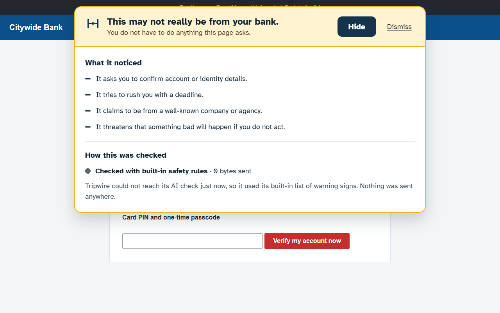
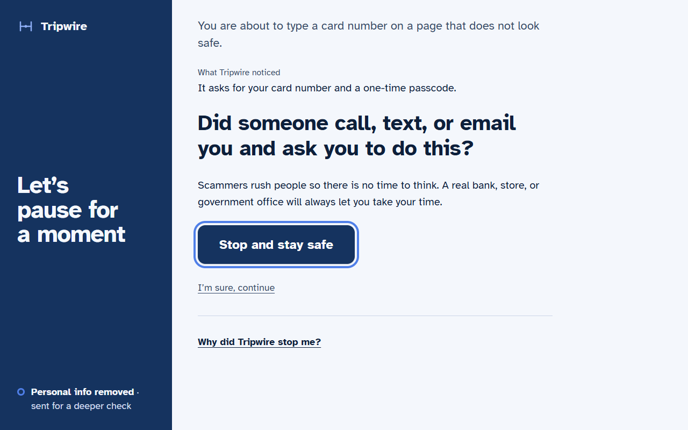
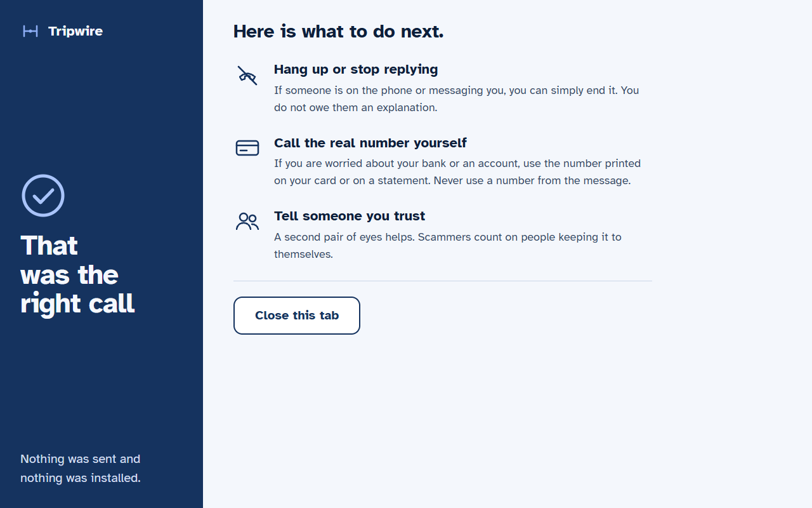
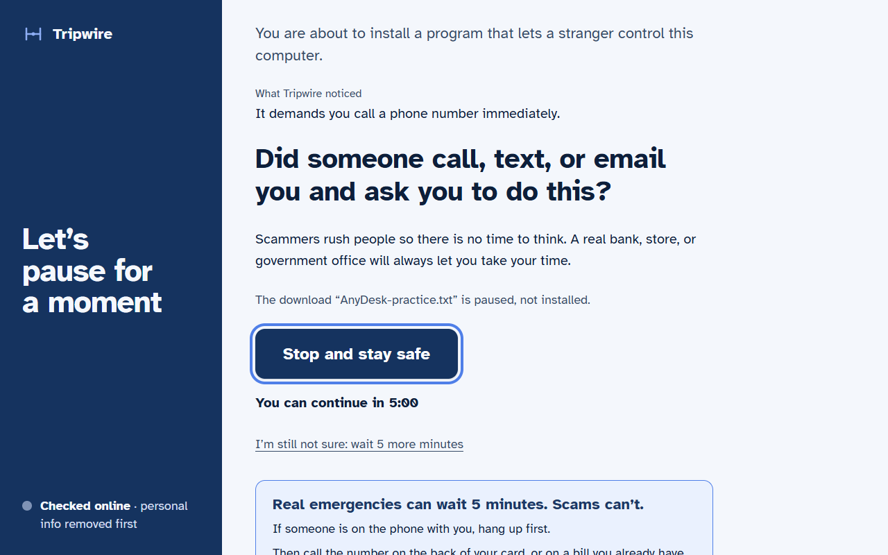
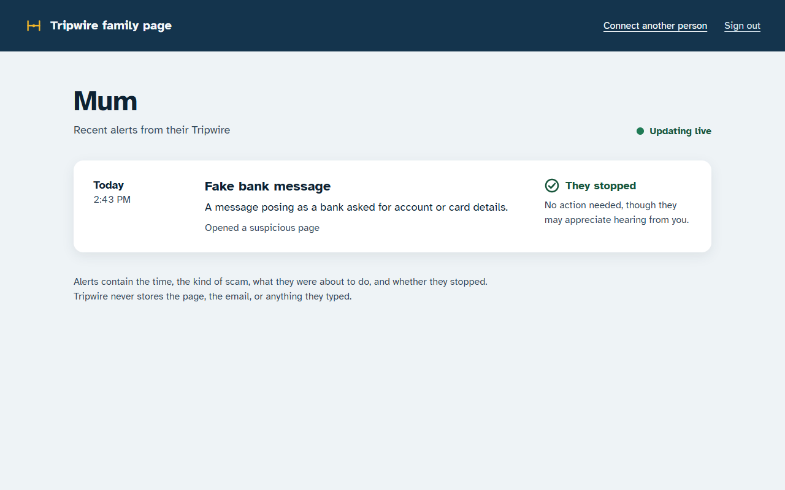

# Tripwire

**Tripwire steps in at the exact moment you're about to fall for a scam, and protects your privacy while doing it.**

A Chrome extension for older adults and the family who look out for them. Built for the Firebase #BuildHybridAI 2026 hackathon (Web / Chrome track). Licensed under Apache-2.0.

Scams do not take your money when you read them. They take it when you act: when you type a card number, buy gift cards, install a "support" program, or call the number on the screen. Tripwire stays invisible until that moment, then pauses you with one calm question: *did someone call, text, or email you and ask you to do this?*

## What it does

| State | What the person sees |
| --- | --- |
| Safe | Nothing at all. No badge, no banner. |
| Caution | A calm amber banner with one plain sentence, a "Why?" button and "Dismiss". |
| Tripped | A full-page pause. "Stop and stay safe" is the big button; "I'm sure, continue" is a quiet link. |

Action tripwires: typing or focusing a card number field (Luhn checked, locally), gift-card code fields, crypto wallet fields, `tel:` links on a suspicious page, and downloads of remote-access tools shortly after a suspicious page was open.

**Family Guardian** (optional): the person shows a six-digit code, a family member types it on the family page, and from then on sees a live feed of *that Tripwire stepped in*: the time, the kind of scam, the action, and whether they stopped. Never the page, the email, or anything typed. There is a web family page and an Android app (see [Android companion](#android-companion)).

**Settings**: a three-step warning level (fewer warnings, standard, more careful) and a list of trusted sites that Tripwire never checks. The trusted-sites screen carries a warning written for the exact way a scammer would try to abuse it.

**Explanations in your language**: when the browser is not set to English, the reasons are written in the browser's language. A verdict that never left the device is translated on the device, so "0 bytes sent" stays true; a verdict that used the cloud is written in that language by the cloud model. Buttons and headings stay in English.

## Screenshots

Captured by `npm run e2e` from the built extension running in Chromium, on the practice pages.

| Caution | Tripped |
| --- | --- |
|  |  |

| After stopping | A paused download |
| --- | --- |
|  |  |

| Setup: the privacy promise | Popup |
| --- | --- |
|  |  |

| Settings | Family page: alerts (sample data) |
| --- | --- |
|  |  |

## How it uses Firebase AI Logic

All AI inference goes through Firebase AI Logic (`firebase/ai`), in one file: [src/inference/firebaseEngine.ts](src/inference/firebaseEngine.ts). There are no other model APIs anywhere in the codebase, and no Gemini API key: the Firebase AI Logic proxy holds it server-side.

The on-device model is used as a **privacy gate in front of the cloud**:

```
page text
   │
   ▼
built-in warning signs (rules, no AI) ── nothing suspicious ──► not checked, 0 bytes sent
   │
   ▼
Gemini Nano on the device (InferenceMode.ONLY_ON_DEVICE)
   │  low risk ────────────────────────────────────────────────► safe, 0 bytes sent
   │  high risk, confident, rules agree ───────────────────────► TRIPPED, 0 bytes sent
   ▼  unsure
regex redaction → on-device model redaction → regex again → leak check (fails closed)
   │
   ▼
Gemini in the cloud (InferenceMode.ONLY_IN_CLOUD), redacted text only
   │
   ▼
merged verdict: safe / caution / tripped
```

Every verdict carries a `route`, shown to the person in plain words:

- **Checked on your device · 0 bytes sent**
- **Personal info removed · sent for a deeper check**
- **Your device doesn't support on-device AI · personal info removed before checking**
- **Checked with built-in safety rules · 0 bytes sent** (offline, or no model reachable)

Details worth knowing:

- The router ([src/inference/router.ts](src/inference/router.ts)) pins the inference mode for each call instead of using `PREFER_ON_DEVICE`, and checks `response.inferenceSource`. If a call that must stay on the device was answered by the cloud, it throws a `PrivacyInvariantError` and the result is discarded.
- Model output is structured JSON validated with zod. A bad answer is retried once, then Tripwire fails **safe** (caution), never open.
- Thresholds, prompt version and keyword lists come from **Remote Config** (parameter `tripwire_config`, JSON) with local defaults in [src/config/defaults.ts](src/config/defaults.ts).
- **App Check** is initialised before any AI or Firestore call. reCAPTCHA cannot load on a `chrome-extension://` origin under Manifest V3, so the extension uses a `CustomProvider` with a debug token from `.env`. A production build would back that provider with a Cloud Function that mints tokens. The hosted family page attests with reCAPTCHA Enterprise, and the Android app uses the debug provider in debug builds and Play Integrity in release builds. **App Check is enforced on both Firebase AI Logic and Firestore.**
- Chrome's Prompt API is not available in service workers, so inference runs in an **offscreen document** ([src/entrypoints/offscreen](src/entrypoints/offscreen/main.ts)).
- Other Firebase products: anonymous **Auth** (the device identity), **Firestore** (pairing codes and alerts), **Hosting** (family page).

## Privacy guarantees, and where they are enforced

| Promise | Enforced by |
| --- | --- |
| Raw page or email text never reaches the cloud model | `redactForCloud` fails closed; router tests assert the cloud prompt contains no raw PII ([tests/router.test.ts](tests/router.test.ts)) |
| Password fields are never read | [src/tripwires/cardField.ts](src/tripwires/cardField.ts); only visible text is scanned |
| A Guardian alert holds five fixed fields and nothing else | `buildAlert` takes enums only; [firestore.rules](firestore.rules) reject extra fields and long strings ([tests/rules](tests/rules/guardian.rules.test.ts)) |
| A guardian can only link with a live code | Security rules check the code server-side; codes cannot be listed |
| Nothing is stored about pages | Verdicts live in `chrome.storage.session` and are cleared when the tab closes |

## Run it

Requirements: Node 22+, Chrome 139+ on desktop.

```bash
npm install
```

```bash
npm run build
```

Then open `chrome://extensions`, turn on **Developer mode**, choose **Load unpacked**, and pick the `.output/chrome-mv3` folder. Tripwire opens its three-screen setup.

Without any Firebase project the extension still works on its built-in safety rules (route: "Checked with built-in safety rules"). To see it step in right away:

```bash
npm run demo
```

Then press **Try a practice example** in the Tripwire popup, or open `http://localhost:4174/`. The practice pages in [demo/](demo) are invented scams (fake bank, fake tech support, gift cards, crypto) plus one ordinary checkout where Tripwire must stay silent.

A hosted copy of the family page is at https://tripwire-buildhybridai.web.app and the practice pages are at https://tripwire-buildhybridai.web.app/demo/.

### Connect Firebase (for the AI and Family Guardian)

1. Create a Firebase project and add a **Web app**. Copy `.env.example` to `.env` and paste the web config values.
2. **AI Logic**: in the console open *AI Logic*, choose **Gemini Developer API**, and enable it.
3. **App Check**: register the web app. Generate a UUID, add it under *Manage debug tokens*, and put it in `.env` as `WXT_APPCHECK_DEBUG_TOKEN`. Never commit it. For a hosted family page, also add a reCAPTCHA v3 site key as `WXT_RECAPTCHA_SITE_KEY`.
4. **Authentication**: enable *Anonymous* and *Google*.
5. **Firestore**: create a database, then deploy the rules and the family page:

```bash
npm run deploy:dashboard
```

6. Set `WXT_DASHBOARD_URL` in `.env` to the hosting address, then `npm run build` again and reload the extension.
7. **Remote Config** (optional): add a parameter `tripwire_config` holding JSON in the shape of `DEFAULT_CONFIG`.

### On-device model

Gemini Nano needs Chrome 139+ on a desktop with about 22 GB of free disk and either more than 4 GB of VRAM or 16 GB RAM with 4+ cores. Enable `chrome://flags/#prompt-api-for-gemini-nano-multimodal-input`, restart Chrome, then press **Get private checking ready** on Tripwire's setup screen 2 (the download needs a click). The popup's **Developer checks** page runs one on-device call, one hybrid call and the whole test corpus live, and reports which side answered.

**Signature demo:** once the model is downloaded, turn off Wi-Fi and open a practice page. Tripwire still catches it, and the badge reads "Checked on your device · 0 bytes sent".

## Android companion

`android/` holds **Tripwire Guardian**, a native Android app (Kotlin, Jetpack Compose) for the family member.

- Pair with the same six-digit code, then see the same live alert feed as the web family page.
- A notification when a new alert arrives while the app is running.
- **"What should I say to them?"** writes three kind sentences for a phone call. This is the app's AI feature and it goes through **Firebase AI Logic hybrid inference** (`InferenceMode.PREFER_ON_DEVICE`): Gemini Nano on the phone when it has one, the cloud model otherwise. The prompt is built only from the kind of scam and whether they stopped, so nothing personal can reach a model. Under every suggestion the app says where it was written: "Written on this phone · nothing was sent" or "Written online · only the kind of scam was sent". If neither can answer, it shows built-in advice and says so.
- App Check: the debug provider in debug builds, Play Integrity in release builds.

Build it (JDK 17 and the Android SDK needed):

1. Register an Android app with package `app.tripwire.guardian` in the Firebase project and save its `google-services.json` to `android/app/`.
2. Register an App Check debug token for it and put it in `android/local.properties` as `appcheck.debugToken=<uuid>`. Neither file is committed.
3. Run `./gradlew assembleDebug` in `android/`. The APK lands in `android/app/build/outputs/apk/debug/`.

Status: the app compiles against firebase-ai 18.2.0 and firebase-ai-ondevice 16.0.0-beta08, its 6 unit tests pass and the debug APK builds. **It has not been run on a phone or emulator yet** (see "Not verified yet"). Alerts do not arrive while the app is closed: that needs push messaging from a server, which is outside this free-tier build.

## Commands

| Command | What it does |
| --- | --- |
| `npm run dev` | Extension with hot reload |
| `npm run build` | Production build into `.output/chrome-mv3` |
| `npm run demo` | Practice scam pages on `localhost:4174` |
| `npm run dev:dashboard` | Family page on `localhost:5174` (`/preview.html` is a development-only screen gallery) |
| `npm run typecheck` | TypeScript, strict |
| `npm test` | Unit tests: redaction, router, practice pages |
| `npm run test:rules` | Firestore rules against the emulator (needs JDK 21+; with JDK 17 run `npx firebase-tools@14 emulators:exec --only firestore --project demo-tripwire "npx vitest run tests/rules"`) |
| `npm run eval` | Corpus run with rules only; exits non-zero on any false alarm |
| `npm run live` | With `.env` filled in: live App Check, hybrid call, the corpus through the live router, pairing and a family alert |
| `cd android && ./gradlew testDebugUnitTest assembleDebug` | Android companion: unit tests and debug APK |
| `npm run e2e` | Loads the built extension in Chromium, drives the practice pages, saves screenshots (first run: `npx playwright install chromium`) |

## Test results

Corpus: 25 scam and 25 ordinary messages in [corpus/](corpus).

| Run | Scams flagged | False alarms | Bytes sent |
| --- | --- | --- | --- |
| Built-in rules only (`npm run eval`) | 23 / 25 (3 paused) | **0 / 25** | 0 |
| Live through Firebase AI Logic, cloud path (`npm run live`) | **25 / 25** (25 paused) | **0 / 25** | 14,162, all redacted first |
| Live, Gemini Nano on the device first (`node scripts/nano-probe.mjs --checks --corpus`) | **25 / 25** (25 paused), five runs | **0 / 25**, five runs | 310 to 3,013 per run, all redacted first |

The two misses on rules alone are refund-style messages with few warning words; the model catches both. In the cloud-path run 15 of the 50 samples were never sent anywhere (no warning signs), and the other 35 went to the cloud only after redaction. Raw results: [eval-results/live.json](eval-results/live.json).

**With the on-device model, 29 to 36 of the 50 samples were decided entirely on the device, 13 needed no model at all, and 1 to 8 went to the cloud: 310 to 3,013 redacted bytes per run, against 14,162 without the on-device gate.** Raw results of the last run: [eval-results/live-on-device.json](eval-results/live-on-device.json). These runs used desktop Chrome 157 with Gemini Nano, through the Developer checks page served as a web page (Chrome will not load an unpacked extension under automation). The on-device model's answers vary a little from run to run, so the corpus was run five times after the last router change; all five had zero false alarms. A run before that produced one borderline false alarm on a gift-card shop page, which led to a router fix and a regression test (a confident "this is fine" from the cloud model now overrules an unsure device model).

The same live run (`npm run live`) also checks, against the real project: an App Check token is issued for the extension, one hybrid Firebase AI Logic call answers, a pairing code is created, a guardian pairs on the hosted family page, and stopping a scam makes an alert appear there within seconds.



Unit tests: 105 passing (extension) and 6 passing (Android). Security-rules tests: 12 passing. End-to-end in Chromium: 12 of 12 steps passing (setup, silent on an ordinary checkout, banner, pause on card / gift card / wallet / phone link, paused download, stop, continue, trusted sites in settings, popup, family page gallery).

Explanations in the browser's language were run live: Spanish and French on the device (route "Checked on your device", 0 bytes sent) and Spanish through the cloud path.

Accessibility: the same run audits every screen with axe-core. WCAG 2.2 A/AA: 0 problems. All text also meets AAA contrast (7:1).

## Not verified yet

Stated plainly so nobody is surprised:

- The automated on-device runs go through a web page, because Chrome will not load an unpacked extension under automation. The loaded extension itself was checked by hand in desktop Chrome 157 on 2026-11-14: the offscreen document reported the model as ready, and the fake bank practice page was paused with the badge "Checked on your device · 0 bytes sent". The Wi-Fi-off run has not been done yet.
- Scanning inside Gmail has not been tested against a real mailbox.
- The Android app has not been run. It builds and its unit tests pass, but the machine it was built on has no hypervisor, so the Android emulator cannot start, and no phone was attached. Pairing, the feed, notifications and the hybrid AI call on Android are therefore untested on a device.
- App Check enforcement was tested from outside: an AI Logic request without a token is refused with HTTP 401, and a Firestore read without a token is refused (`node scripts/appcheck-probe.mjs`), while the extension and the hosted family page keep working.

## Project layout

```
src/inference     router, prompts, schemas, the single Firebase AI Logic file
src/redaction     regex redactor and the fail-closed redaction pipeline
src/tripwires     card-field detection and Luhn
src/content       page text scanning (visible text only)
src/background    service worker: relays checks, tab state, download tripwire
src/entrypoints   content script, popup, onboarding, pause, safe, checks, offscreen
src/ui            every word of copy (copy.ts), design tokens (tripwire.css), shared components
src/guardian      pairing and alerts
android           Tripwire Guardian, the Android companion (Kotlin, Compose)
dashboard         family page (Vite + React), shares src/ui
demo              practice scam pages
corpus, tests     test corpus, unit tests, security-rules tests
```

Design notes are in [DESIGN.md](DESIGN.md) and [PRODUCT.md](PRODUCT.md).

## Credits

Typeface: Atkinson Hyperlegible by the Braille Institute, SIL Open Font License. Every company, person, phone number and amount in the practice pages and the corpus is invented.
