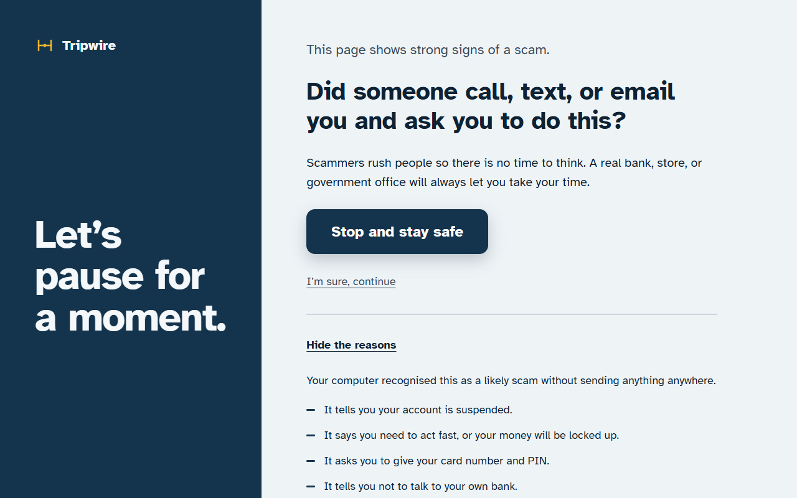
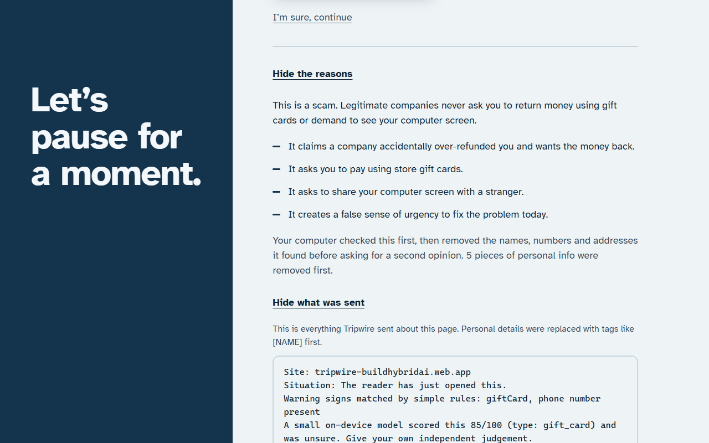
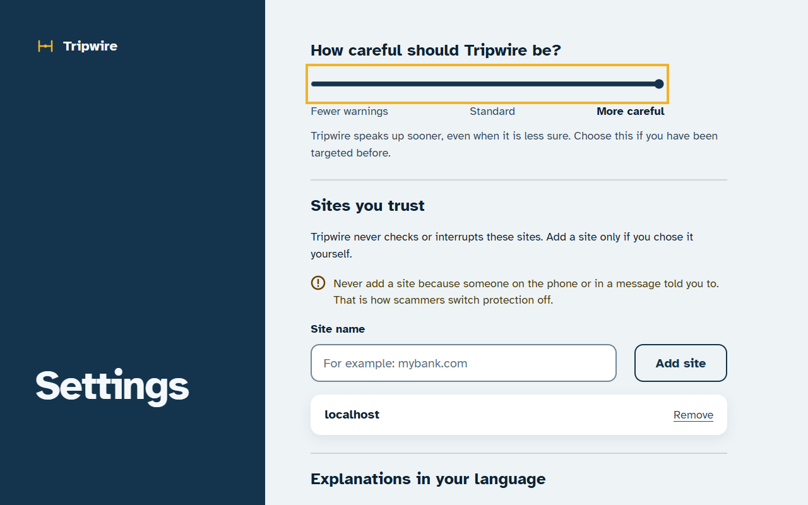
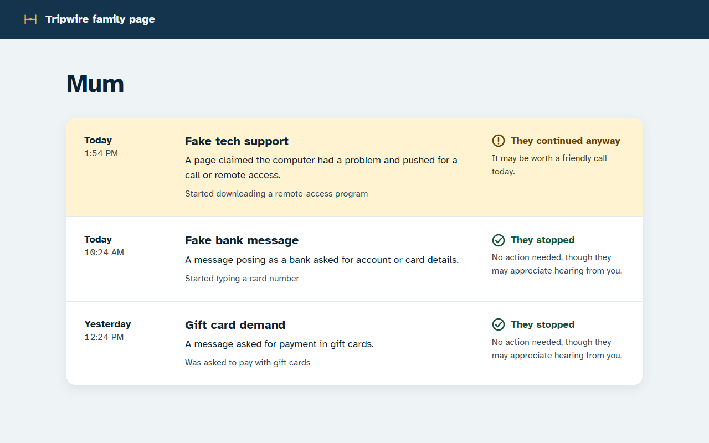

# Tripwire

**Tripwire steps in at the exact moment you're about to fall for a scam, and protects your privacy while doing it.**

A Chrome extension for older adults and the family who look out for them. Built for the Firebase #BuildHybridAI 2026 hackathon (Web / Chrome track). Licensed under Apache-2.0.

Scams do not take your money when you read them. They take it when you act: when you type a card number, buy gift cards, install a "support" program, or call the number on the screen. Tripwire stays invisible until that moment, then pauses you with one calm question: *did someone call, text, or email you and ask you to do this?*

**Try it now, with nothing to install:** https://tripwire-buildhybridai.web.app/demo/ runs Tripwire's real checks and screens in your browser, through Firebase AI Logic. If your Chrome has its on-device model the check runs on your device; otherwise personal details are removed first and the cloud model is asked.

## Why this matters

Figures from the US Federal Trade Commission, read in November 2026:

- Fraud losses reported by older adults rose from about $600 million in 2020 to about $3 billion in 2025 ([FTC consumer alert, 4 Nov 2026](https://consumer.ftc.gov/consumer-alerts/2026/11/new-report-ftcs-work-protect-older-adults)).
- Reports from older adults who lost $10,000 or more to business or government imposters rose more than fourfold from 2020 to 2024 (1,790 to 8,269 reports). In 2024 older adults were more than twice as likely as younger adults to report a loss that size ([FTC Data Spotlight, Aug 2025](https://www.ftc.gov/news-events/data-visualizations/data-spotlight/2025/08/false-alarm-real-scam-how-scammers-are-stealing-older-adults-life-savings)).
- The pattern the FTC describes is the one Tripwire is built around: a false alarm ("someone is using your accounts"), then pressure to move money "to protect it". Its advice: "Only scammers will tell you to buy a gift card ... and give them the numbers off the back of the card" ([FTC](https://consumer.ftc.gov/articles/avoiding-and-reporting-gift-card-scams)).

These are published figures, not our own research. Tripwire has not been tested with older users yet; `PRODUCT.md` says so.

## How this differs from the protection already in a browser

Browsers block known bad sites and warn about dangerous pages. Tripwire does four different things:

1. **It acts at the moment of action**, not on page load: a card field, a gift-card code box, a wallet address, a phone link, a remote-access download.
2. **It reads the message, not the address.** A brand-new scam email on an ordinary mail site has no bad URL to block.
3. **It shows its work.** Every verdict says what left the computer, and "See exactly what was sent" shows the redacted text itself.
4. **It brings in family** without showing them anything private.

## What it does

| State | What the person sees |
| --- | --- |
| Safe | Nothing at all. No badge, no banner. |
| Caution | A calm amber banner with one plain sentence, a "Why?" button and "Dismiss". |
| Tripped | A full-page pause. "Stop and stay safe" is the big button; "I'm sure, continue" is a quiet link. |

Action tripwires: typing or focusing a card number field (Luhn checked, locally), gift-card code fields, crypto wallet fields, `tel:` links on a suspicious page, and downloads of remote-access tools shortly after a suspicious page was open.

**Family Guardian** (optional): the person shows a six-digit code, a family member types it on the family page, and from then on sees a live feed of *that Tripwire stepped in*: the time, the kind of scam, the action, and whether they stopped. Never the page, the email, or anything typed. There is a web family page and an Android app (see [Android companion](#android-companion)).

**Settings**: a three-step warning level (fewer warnings, standard, more careful) and a list of trusted sites that Tripwire never checks. The trusted-sites screen carries a warning written for the exact way a scammer would try to abuse it.

**Explanations in your language**: when the browser is not set to English, the reasons are written in the browser's language. A verdict that never left the device is translated on the device, so "0 bytes sent" stays true; a verdict that used the cloud is written in that language by the cloud model. Buttons and headings stay in English.

## Screenshots

The first row was captured in desktop Chrome 157 with Gemini Nano answering, on the hosted practice pages (`node scripts/nano-probe.mjs --shots`). The rest come from `npm run e2e` in a Chromium that has no on-device model, so their badges show the fallback route.

| On the device, nothing sent | The receipt: exactly what was sent |
| --- | --- |
|  |  |

| Caution | Tripped |
| --- | --- |
|  |  |

| After stopping | A paused download |
| --- | --- |
|  |  |

| Setup: the privacy promise | Popup |
| --- | --- |
|  |  |

| Settings | Family page: alerts (sample data) |
| --- | --- |
|  |  |

## How it uses Firebase AI Logic

All AI inference goes through Firebase AI Logic (`firebase/ai`), in one file: [src/inference/firebaseEngine.ts](src/inference/firebaseEngine.ts). There are no other model APIs anywhere in the codebase, and no Gemini API key: the Firebase AI Logic proxy holds it server-side.

The on-device model is used as a **privacy gate in front of the cloud**:

```
page text
   │
   ▼
built-in warning signs (rules, no AI) ── nothing suspicious ──► not checked, 0 bytes sent
   │
   ▼
Gemini Nano on the device (InferenceMode.ONLY_ON_DEVICE)
   │  low risk ────────────────────────────────────────────────► safe, 0 bytes sent
   │  high risk, confident, rules agree ───────────────────────► TRIPPED, 0 bytes sent
   ▼  unsure
regex redaction → on-device model redaction → regex again → leak check (fails closed)
   │
   ▼
Gemini in the cloud (InferenceMode.ONLY_IN_CLOUD), redacted text only
   │
   ▼
merged verdict: safe / caution / tripped
```

Every verdict carries a `route`, shown to the person in plain words:

- **Checked on your device · 0 bytes sent**
- **Personal info removed · sent for a deeper check**
- **Your device doesn't support on-device AI · personal info removed before checking**
- **Checked with built-in safety rules · 0 bytes sent** (offline, or no model reachable)

What decides each step (all of this was changed after a held-out test, see "Test results"):

- **The gate is the shape of the request, not just keywords.** A page is worth a look when it asks for money or credentials and adds pressure, secrecy or a number to call ([src/inference/shape.ts](src/inference/shape.ts)). The on-device look is generous, because it sends nothing. With no on-device model the bar is higher, because something would leave the device.
- **Models read an excerpt, not the page.** A long page is cut to its opening plus the sentences that carry the ask (at most 1,800 characters). This keeps the on-device model to a few seconds and means less can ever be sent.
- **On-device redaction lists, code replaces.** The on-device model returns the personal details it finds; the replacing is done in code, so nothing can be paraphrased or dropped, and it is several times faster than asking a small model to rewrite the text.
- **A page that is about scams never trips on the small model alone.** Advice pages and encyclopaedia articles contain every scam phrase there is; the cloud model has to agree.

Details worth knowing:

- The router ([src/inference/router.ts](src/inference/router.ts)) pins the inference mode for each call instead of using `PREFER_ON_DEVICE`, and checks `response.inferenceSource`. If a call that must stay on the device was answered by the cloud, it throws a `PrivacyInvariantError` and the result is discarded.
- Model output is structured JSON validated with zod. A bad answer is retried once, then Tripwire fails **safe** (caution), never open.
- Thresholds, prompt version and keyword lists come from **Remote Config** (parameter `tripwire_config`, JSON) with local defaults in [src/config/defaults.ts](src/config/defaults.ts).
- **App Check** is initialised before any AI or Firestore call. reCAPTCHA cannot load on a `chrome-extension://` origin under Manifest V3, so the extension uses a `CustomProvider` with a debug token from `.env`. A production build would back that provider with a Cloud Function that mints tokens. The hosted family page attests with reCAPTCHA Enterprise, and the Android app uses the debug provider in debug builds and Play Integrity in release builds. **App Check is enforced on both Firebase AI Logic and Firestore.**
- Chrome's Prompt API is not available in service workers, so inference runs in an **offscreen document** ([src/entrypoints/offscreen](src/entrypoints/offscreen/main.ts)).
- Other Firebase products: anonymous **Auth** (the device identity), **Firestore** (pairing codes and alerts), **Hosting** (family page).

## Privacy guarantees, and where they are enforced

| Promise | Enforced by |
| --- | --- |
| Raw page or email text never reaches the cloud model | `redactForCloud` fails closed; router tests assert the cloud prompt contains no raw PII ([tests/router.test.ts](tests/router.test.ts)) |
| Password fields are never read | [src/tripwires/cardField.ts](src/tripwires/cardField.ts); only visible text is scanned |
| A Guardian alert holds five fixed fields and no free text | `buildAlert` takes enums only; [firestore.rules](firestore.rules) require the summary to be the one fixed sentence for that kind of scam and reject anything else ([tests/rules](tests/rules/guardian.rules.test.ts), 14 tests) |
| The person can see what was sent | "See exactly what was sent" in the reasons panel shows the redacted request text ([src/ui/kit.tsx](src/ui/kit.tsx)) |
| A pairing code works once | The extension deletes the code when a family member connects and says so; settings can disconnect everyone |
| A guardian can only link with a live code | Security rules check the code server-side; codes cannot be listed |
| Nothing is stored about pages | Verdicts live in `chrome.storage.session` and are cleared when the tab closes |

**What is not guaranteed.** On a computer with no on-device model, redaction is pattern-matching: numbers, emails, addresses, greetings, titles and about 300 common given names. An unusual name in ordinary prose can get through, which is why that route is worded "the names, numbers and addresses it could recognise". "Bytes sent" counts the whole request Tripwire writes about a page (redacted text, site name, context lines); the fixed instructions are the same for every page and are not counted.

## Run it

Requirements: Node 22+, Chrome 139+ on desktop.

```bash
npm install
```

```bash
npm run build
```

Then open `chrome://extensions`, turn on **Developer mode**, choose **Load unpacked**, and pick the `.output/chrome-mv3` folder. Tripwire opens its three-screen setup.

Without any Firebase project the extension still works on its built-in safety rules (route: "Checked with built-in safety rules"). To see it step in right away:

```bash
npm run demo
```

Then press **Try a practice example** in the Tripwire popup, or open `http://localhost:4174/`. The practice pages in [demo/](demo) are invented scams (fake bank, fake tech support, gift cards, crypto) plus one ordinary checkout where Tripwire must stay silent.

A hosted copy of the family page is at https://tripwire-buildhybridai.web.app and the practice pages are at https://tripwire-buildhybridai.web.app/demo/.

### Connect Firebase (for the AI and Family Guardian)

1. Create a Firebase project and add a **Web app**. Copy `.env.example` to `.env` and paste the web config values.
2. **AI Logic**: in the console open *AI Logic*, choose **Gemini Developer API**, and enable it.
3. **App Check**: register the web app. Generate a UUID, add it under *Manage debug tokens*, and put it in `.env` as `WXT_APPCHECK_DEBUG_TOKEN`. Never commit it. For a hosted family page, also add a reCAPTCHA v3 site key as `WXT_RECAPTCHA_SITE_KEY`.
4. **Authentication**: enable *Anonymous* and *Google*.
5. **Firestore**: create a database, then deploy the rules and the family page:

```bash
npm run deploy:dashboard
```

6. Set `WXT_DASHBOARD_URL` in `.env` to the hosting address, then `npm run build` again and reload the extension.
7. **Remote Config** (optional): add a parameter `tripwire_config` holding JSON in the shape of `DEFAULT_CONFIG`.

### On-device model

Gemini Nano needs Chrome 139+ on a desktop with about 22 GB of free disk and either more than 4 GB of VRAM or 16 GB RAM with 4+ cores. Enable `chrome://flags/#prompt-api-for-gemini-nano-multimodal-input`, restart Chrome, then press **Get private checking ready** on Tripwire's setup screen 2 (the download needs a click). The popup's **Developer checks** page runs one on-device call, one hybrid call and the whole test corpus live, and reports which side answered.

**Signature demo:** once the model is downloaded, turn off Wi-Fi and open a practice page. Tripwire still catches it, and the badge reads "Checked on your device · 0 bytes sent".

## Android companion

`android/` holds **Tripwire Guardian**, a native Android app (Kotlin, Jetpack Compose) for the family member.

- Pair with the same six-digit code, then see the same live alert feed as the web family page.
- A notification when a new alert arrives while the app is running.
- **"What should I say to them?"** writes three kind sentences for a phone call. This is the app's AI feature and it goes through **Firebase AI Logic hybrid inference** (`InferenceMode.PREFER_ON_DEVICE`): Gemini Nano on the phone when it has one, the cloud model otherwise. The prompt is built only from the kind of scam and whether they stopped, so nothing personal can reach a model. Under every suggestion the app says where it was written: "Written on this phone · nothing was sent" or "Written online · only the kind of scam was sent". If neither can answer, it shows built-in advice and says so.
- App Check: the debug provider in debug builds, Play Integrity in release builds.

Build it (JDK 17 and the Android SDK needed):

1. Register an Android app with package `app.tripwire.guardian` in the Firebase project and save its `google-services.json` to `android/app/`.
2. Register an App Check debug token for it and put it in `android/local.properties` as `appcheck.debugToken=<uuid>`. Neither file is committed.
3. Run `./gradlew assembleDebug` in `android/`. The APK lands in `android/app/build/outputs/apk/debug/`.

Status: the app compiles against firebase-ai 18.2.0 and firebase-ai-ondevice 16.0.0-beta08, its 6 unit tests pass and the debug APK builds. **It has not been run on a phone or emulator yet** (see "Not verified yet"). Alerts do not arrive while the app is closed: that needs push messaging from a server, which is outside this free-tier build.

## Commands

| Command | What it does |
| --- | --- |
| `npm run dev` | Extension with hot reload |
| `npm run build` | Production build into `.output/chrome-mv3` |
| `npm run demo` | Practice scam pages on `localhost:4174` |
| `npm run dev:dashboard` | Family page on `localhost:5174` (`/preview.html` is a development-only screen gallery) |
| `npm run typecheck` | TypeScript, strict |
| `npm test` | Unit tests: redaction, router, practice pages |
| `npm run test:rules` | Firestore rules against the emulator (needs JDK 21+; with JDK 17 run `npx firebase-tools@14 emulators:exec --only firestore --project demo-tripwire "npx vitest run tests/rules"`) |
| `npm run eval` | Corpus run with rules only; exits non-zero on any false alarm |
| `npm run live` | With `.env` filled in: live App Check, hybrid call, the corpus through the live router, pairing and a family alert |
| `cd android && ./gradlew testDebugUnitTest assembleDebug` | Android companion: unit tests and debug APK |
| `npm run hosted` | Tests the zero-install demo on the hosted site in a plain browser |
| `node scripts/holdout.mjs` | Held-out scams and real public pages, with the on-device model and latency |
| `npm run e2e` | Loads the built extension in Chromium, drives the practice pages, saves screenshots (first run: `npx playwright install chromium`) |

## Test results

### Main corpus

25 scam and 25 ordinary messages in [corpus/](corpus). Keyword lists and thresholds were tuned on this set, so treat it as a regression test, not as proof.

| Run | Scams flagged | False alarms | Bytes sent (whole request) |
| --- | --- | --- | --- |
| Built-in rules only (`npm run eval`) | 23 / 25 | **0 / 25** | 0 |
| Cloud path, no on-device model (`npm run live`) | **25 / 25** | **0 / 25** | 21,613, all redacted first |
| Gemini Nano on the device first (`node scripts/nano-probe.mjs --checks --corpus`) | **25 / 25** | **0 / 25** | 2,554, all redacted first |

With the on-device model, 38 of the 50 samples were decided on the device, 8 needed no model and 4 went to the cloud: about 88 percent less sent than the cloud-only path, with the same detection. Four on-device runs are committed in [eval-results/on-device/](eval-results/on-device): three from 14 Nov, which counted only the page text as "bytes sent" (so their byte figures are lower and not comparable), and the one above. All four are 25/25 with zero false alarms. Three more were run on 14 Nov and not kept: two matched, and the first one produced a borderline false alarm on a gift-card shop page, which led to a router fix and a regression test. Results files record where they were run; the on-device runs use the Developer checks page served as a web page, because Chrome will not load an unpacked extension under automation.

### Held-out test, and what it found

[corpus/holdout.json](corpus/holdout.json): scam messages that were never used for tuning (longer and quieter than the main corpus), and 20 real public pages fetched live: official advice about scams (IRS, SSA, CFPB, Apple, USPS, GOV.UK), remote-access vendors, Wikipedia articles on tech support scams, gift cards and wire transfers, a gift-card buying guide, Bitcoin's own explainer, and news. Run with `node scripts/holdout.mjs`.

| Run | Scams flagged | False alarms on real pages | Check time when a model ran |
| --- | --- | --- | --- |
| First run, original design | 6 / 10 | 0 / 16 | median 51 s |
| After the fixes below | **16 / 16** | **0 / 16** | **median 4.3 s, 90th percentile 8.4 s** |

The first run was a bad result and it was right:

- **Four of ten scams never reached a model.** The keyword gate was tuned to the main corpus and missed a "grandchild needs bail" message, a utility shut-off notice, a refund call and a customs fee. The gate now looks at the shape of the request.
- **Long real pages took about 50 seconds**, because the on-device model was handed whole pages and timed out. Models now read a focused excerpt, a timeout is not retried, and on-device redaction lists details instead of rewriting text.
- A middle run then **paused the Wikipedia article on tech support scams**. Pages that are about scams now need the cloud model to agree.

Because those fixes were made after seeing round one, a second round of six new scam messages was written afterwards and nothing was changed after running it: 6 of 6 were caught. The real pages are no longer strictly held-out either (one false alarm on them was found and fixed), so the "0 of 16" is a result on pages the design has now seen. Four pages (three on consumer.ftc.gov and anydesk.com) refused the automated browser and were skipped. All runs are in [eval-results/holdout/](eval-results/holdout).

### Everything else

- Unit tests: 123 passing (extension), 6 (Android). Security-rules tests against the emulator: 14 passing.
- End-to-end in Chromium (`npm run e2e`): 12 of 12 steps, including settings and the paused download.
- Live against the real project (`npm run live`): App Check token, hybrid call, Spanish explanations, pairing, single-use code, family alert.
- Hosted demo with no extension (`npm run hosted`): the practice pages are flagged in a plain browser, the phone number on the page is absent from what was sent, and the ordinary checkout stays silent.
- Accessibility: axe-core on every screen in the end-to-end run. WCAG 2.2 A/AA: 0 problems. All text meets AAA contrast.
- Languages: the banner, pause, reasons and "you stopped" page are in English, Spanish and French, following the browser. Model-written reasons were run live in Spanish and French on the device (0 bytes sent) and Spanish through the cloud.

## Not verified yet

Stated plainly so nobody is surprised:

- **Gmail.** Reading an opened email relies on Gmail's page structure and has not been tested against a real mailbox.
- **On-device inside the loaded extension, by automation.** The automated on-device runs go through a web page or the hosted demo. The loaded extension itself was checked by hand in desktop Chrome 157 on 14 Nov 2026: the offscreen document reported the model as ready, the fake bank practice page was paused with "Checked on your device · 0 bytes sent", and the same check passed with Wi-Fi off.
- **The Android app has not been run.** It builds and its unit tests pass, but the machine it was built on cannot start the Android emulator and no phone was attached.
- **Real users.** Nobody in the target age group has used it yet.
- **Scale.** The corpora are small (50 tuning samples, 16 held-out scams, 16 real pages). They are enough to catch design mistakes, as above, not to state an accuracy figure.
- **Speed.** A check takes about 3 to 4 seconds on the device and 6 to 9 seconds when the cloud is also asked, on a desktop with an RTX 4060. Reading a page is never blocked by this, but a pause can appear a few seconds after the page does.

## Project layout

```
src/inference     router, request shape and excerpt, prompts, schemas, the single Firebase AI Logic file
src/redaction     regex redactor and the fail-closed redaction pipeline
src/tripwires     card-field detection and Luhn
src/content       page text scanning (visible text only)
src/background    service worker: relays checks, tab state, download tripwire
src/entrypoints   content script, popup, onboarding, pause, safe, checks, offscreen
src/ui            every word of copy (copy.ts), design tokens (tripwire.css), shared components
src/guardian      pairing and alerts
android           Tripwire Guardian, the Android companion (Kotlin, Compose)
dashboard         family page (Vite + React), shares src/ui
demo              practice scam pages (also served as the zero-install demo)
corpus, tests     test corpus, unit tests, security-rules tests
```

Design notes are in [DESIGN.md](DESIGN.md) and [PRODUCT.md](PRODUCT.md).

## Credits

Typeface: Atkinson Hyperlegible by the Braille Institute, SIL Open Font License. Every company, person, phone number and amount in the practice pages and the corpus is invented.
